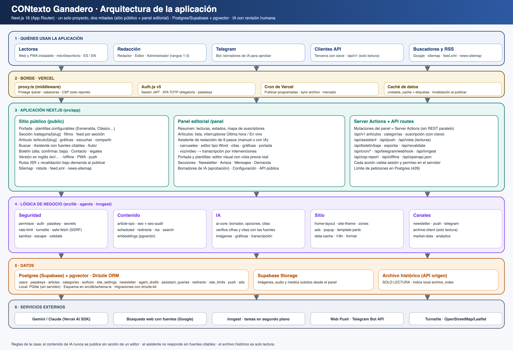

# 1. Propósito, alcance y cómo leer este documento

Este documento describe **cómo está construido y cómo funciona** el portal CONtexto Ganadero (sitio público y panel editorial) con el nivel de detalle que necesita un tercero para **auditarlo, operarlo o mantenerlo** sin depender de quien lo desarrolló. Es la pieza 01 del paquete de documentación de la obligación 19 (ver índice, CG-DOC-00).

Qué cubre: arquitectura, módulos y reglas de dependencia, inventario de rutas y de endpoints, tareas programadas, integraciones externas, variables de entorno, calidad (pruebas e integración continua), despliegue y límites conocidos.
Qué no cubre (está en otros documentos): modelo de datos (CG-DOC-02), manuales de uso (CG-DOC-03 y 04), seguridad (CG-DOC-05), operación y recuperación (CG-DOC-06), cuentas y credenciales (CG-DOC-07) y capacitación (CG-DOC-08).

**Convenciones.** Las rutas de archivo van entre comillas invertidas y son relativas a la raíz del repositorio (`src/lib/…`). Una afirmación de este documento se puede comprobar en el archivo o la prueba automática que se cita junto a ella. Lo que no se pudo verificar desde el código figura en la sección 13 como «pendiente de confirmar».

# 2. Resumen del sistema

| Elemento | Valor |
|---|---|
| Producto | Portal de noticias del sector ganadero y agropecuario de Colombia, con panel editorial, asistente de IA, boletín, observatorio de datos y API pública de solo lectura |
| Repositorio | `github.com/iafedegan/contexto` (rama de producción: `main`) |
| Entorno de producción actual | Vercel, proyecto `contexto` — `https://contexto-olive.vercel.app` (dominio definitivo previsto: `www.contextoganadero.com`, pendiente del corte de dominio) |
| Base de datos de producción | PostgreSQL 17.11 en Supabase, proyecto `CONTEXTOPRO` (región us-east-2), con la extensión `pgvector` 0.8.2 |
| Contenido migrado | 51.381 notas del sitio anterior más las creadas en el portal nuevo (51.382 al 19/10/2026) |
| Tamaño del código | ≈ 67.800 líneas de TypeScript/TSX en `src/`; 208 módulos en `src/lib`, 68 componentes de sitio y 84 de panel |
| Calidad | 81 archivos de prueba, 378 pruebas automáticas en verde; verificación de arquitectura con 0 violaciones |

# 3. Stack tecnológico y versiones

| Capa | Tecnología (versión del `package.json`) | Para qué se usa |
|---|---|---|
| Plataforma de ejecución | Node.js 22 (CI y Vercel) | Ejecución del servidor |
| Framework | Next.js 16.3.8 (App Router), React 19.2.8 | Páginas del sitio y del panel, Server Components y Server Actions |
| Lenguaje | TypeScript 5 | Todo el código |
| Estilos | Tailwind CSS 4, lucide-react, framer-motion | Interfaz y animaciones |
| Acceso a datos | Drizzle ORM 0.45, drizzle-kit 0.31, `postgres` 3.4 (producción), PGlite 0.2 (desarrollo y pruebas) | Consultas tipadas, migraciones |
| Autenticación | Auth.js (`next-auth` 5 beta), `bcryptjs`, `otplib` (TOTP), `@simplewebauthn/server` (passkeys) | Acceso al panel |
| Inteligencia artificial | Vercel AI SDK 7 (`ai`), proveedores `@ai-sdk/google` y `@ai-sdk/anthropic` (también admite OpenAI) | Asistente público, redacción asistida, ideas, gráficas, consejo de redacción |
| Seguridad de contenido | `sanitize-html` | Saneamiento del HTML de las notas |
| Notificaciones | `web-push` (Web Push con VAPID) | Avisos de «Última hora» |
| Trabajos en segundo plano | Inngest 4 | Sincronización del archivo histórico y tareas asíncronas |
| Validación | Zod 4 | Esquemas de entrada y de salida de la IA |
| Pruebas | Runner de Node (`node --test`) con `tsx` | Pruebas unitarias y de integración sobre PGlite |

La lista completa de dependencias y su versión exacta fijada está en `package.json` y `package-lock.json`. Cada despliegue instala con `npm ci` (versiones fijadas por el candado).

# 4. Arquitectura

## 4.1 Estilo: monolito modular

La aplicación es **un solo despliegue Next.js sobre una sola base de datos**, pero su código está dividido en **12 módulos de dominio** con dependencias dirigidas, **verificadas automáticamente** en cada `npm run lint` y en la integración continua (`scripts/check-modulos.mjs`, configuración en `scripts/modulos.config.json`, línea base de violaciones heredadas: **0**).

Principios (detalle en `docs/ARQUITECTURA.md`):

1. Un módulo tiene una responsabilidad de negocio y es dueño de su lógica y de sus tablas.
2. Las dependencias van hacia abajo, nunca en círculo; el grafo permitido es declarativo y verificable.
3. Lo que ocurre en un módulo se **anuncia con eventos** (`src/lib/eventos.ts`, cableado en `src/lib/oyentes.ts`); no se invoca desde fuera.
4. Los módulos de dominio no importan pantallas (`ui-panel`, `ui-sitio`).

## 4.2 Módulos y dependencias permitidas

| Módulo | Responsabilidad | Puede depender de |
|---|---|---|
| `infra` | Esquema y cliente de base de datos, caché de datos, límites de uso y códigos de un solo uso, claves derivadas, descarga segura de URLs externas, política de contenido, política de bots, almacenamiento de medios, utilidades y piezas comunes de interfaz | — |
| `acceso` | Usuarios, sesiones, 2FA, passkeys, cifrado de secretos, roles y permisos | `infra` |
| `archivo` | Archivo histórico (solo lectura) | `infra` |
| `contenido` | Notas, secciones, autores, SEO, búsqueda, programación, redirecciones | `infra`, `acceso` |
| `ia` | Borradores, opciones, gráficas, ideas, noticias, portada, transcripción, verificación de cifras y citas, consejo de redacción | `infra`, `acceso`, `contenido`, `archivo`, `analitica` |
| `portada-tema` | Plantillas, portada, tema, anuncios, ventana emergente, cabecera y pie | `infra`, `acceso`, `contenido` |
| `newsletter` | Suscripción, ediciones y envío del boletín | `infra`, `acceso`, `contenido`, `portada-tema`, `canales` |
| `canales` | Notificaciones push, Telegram, PWA, consentimiento de ubicación | `infra`, `acceso`, `contenido`, `ia` |
| `analitica` | Lecturas, mercado, PageSpeed, mapa de suscriptores | `infra`, `acceso`, `contenido` |
| `orquestacion` | `src/proxy.ts`, tareas Inngest, `src/instrumentation.ts`, cableado de eventos, mantenimiento diario | todos |
| `ui-panel` / `ui-sitio` | Pantallas: componen módulos, no contienen reglas de negocio | todos |
| `otros` | Todo lo no clasificado | todos |

## 4.3 Diagrama

## 4.4 Capas de ejecución

1. **Borde (Vercel):** red de entrega, caché de borde, Firewall y despliegues. Entre la petición y la aplicación actúa `src/proxy.ts`: política de bots, límite de páginas por minuto, redirecciones y enrutamiento del panel.
2. **Aplicación (Next.js):** Server Components para leer, **Server Actions** para toda mutación del panel (no existe una API REST paralela para el panel) y rutas de API para integraciones y tareas programadas.
3. **Datos (Supabase):** un solo PostgreSQL con `pgvector` y almacenamiento de objetos (bucket público `media`).
4. **Servicios externos:** proveedor de IA, correo transaccional, verificación humana, analítica, mensajería (ver sección 9).

## 4.5 Rutas de contenido y caché

- Las **notas y los autores** son páginas estáticas (`revalidate` + `generateStaticParams`).
- La **portada y las categorías** son dinámicas (`force-dynamic`) a propósito: prerenderizarlas obligaba al servidor de compilación a consultar la base y el despliegue fallaba por tiempo de espera. Para no repetir las consultas en cada visita leen de una **caché de datos entre peticiones** (`cachear`, `src/lib/data-cache.ts`; etiquetas `contenido` y `ajustes`, 60 s por defecto).
- La **revalidación bajo demanda** ocurre al publicar desde una Server Action (`revalidarNotas`, `src/lib/article-ops.ts`, único punto que invalida). Las lecturas públicas no escriben en la base.

# 5. Flujos principales

## 5.1 Lectura pública
Petición → proxy (bots, límites) → página estática o dinámica → datos desde la caché de datos o la base → HTML con la plantilla activa (6 plantillas: Esmeralda, Clásico, Revista, Compacto, Vanguardia y Gremial; el tema se define por tokens CSS bajo `[data-theme]`) → medición de lectura (`/api/lectura`, con consentimiento) → conteo diario por nota (`article_views_daily`).

## 5.2 Publicación editorial
Redactor escribe (asistente de 9 pasos, manual o con IA; autoguardado como borrador) → envía a revisión → editor revisa y publica o programa → Server Action invalida la caché y los mapas del sitio → se emite el evento `nota.publicada` → el módulo `canales` envía el aviso push si la nota es de «Última hora». **Ningún contenido generado por IA se publica sin una acción explícita de una persona con permiso de publicar.**

## 5.3 Asistente de IA del público
Consulta → recuperación de fuentes (archivo, notas, Observatorio) → si no hay fuentes citables **no responde** (regla de diseño, verificada por la prueba de humo) → generación con citas → registro en `assistant_queries` → control de presupuesto mensual y de consultas por sesión (`ASSISTANT_MONTHLY_BUDGET_USD`, `ASSISTANT_SESSION_QUERY_LIMIT`).

## 5.4 Consejo de redacción
El editor crea un consejo para una semana, define días y horas, crea **temas** (sección, cobertura, responsable y preguntas que la IA puede contestar investigando en la web) y arma la **pauta** (una pieza por tema). Cada pieza se redacta de una de dos formas: por la IA a su hora (con aprobación previa o automática, solo si la ficha de pauta pasa el control de calidad) o **a mano por el responsable** desde «Mis pendientes» → «Escribir esta nota». El panel ofrece «Tareas del equipo» con el estado y el enlace de cada pieza y avisa a cada responsable de las tareas nuevas. Detalle funcional en `docs/consejo-de-redaccion.md`.

## 5.5 Boletín (newsletter)
Alta con doble confirmación (confirmación por POST, no por GET) → ediciones armadas por secciones y notas → segmentación (tema, ciudad, país, antigüedad) → envío inmediato o programado → baja con enlace firmado → retención y purga de datos personales a diario. Envío por la API de Resend (`src/lib/newsletter/send.ts`).

## 5.6 Migración del archivo histórico
Una sola vez (14/10/2026): descarga del sitio anterior, transformación, copia de imágenes al almacenamiento propio y carga en `articles`, conservando cada dirección original (`legacy_path`) y generando redirecciones 301 donde corresponde. Procedimiento y validación en `docs/migracion-sitio-anterior.md` y `docs/validacion-migracion-2026-10-19.md`.

# 6. Inventario de rutas

## 6.1 Páginas del sitio público (excluye la versión en inglés `/en/…`, que replica las mismas)

| Ruta | Contenido |
|---|---|
| `/` | Portada con la plantilla activa |
| `/categoria/[slug]` | Listado por sección (con filtros de subsección, fechas, región y departamento) |
| `/[seccion]/[slug]` | Nota en su dirección original (`legacy_path`) |
| `/articulo/[slug]` | Nota nueva (sin dirección histórica); `noindex` si es copia de una migrada |
| `/autor/[slug]` | Perfil y notas del autor |
| `/observatorio` | Cifras oficiales del sector (precios, inventario, producción, consumo, internacional, costos) |
| `/buscar` | Búsqueda de texto completo con sugerencias |
| `/asistente` | Asistente de IA con fuentes |
| `/boletin`, `/boletin/confirmar`, `/boletin/baja` | Suscripción, confirmación y baja |
| `/contacto`, `/paute-con-nosotros`, `/feeds` | Contacto, pauta y fuentes RSS |
| `/quienes-somos`, `/politica-editorial`, `/politica-de-ia`, `/politica-de-privacidad`, `/politica-de-cookies`, `/terminos-y-condiciones`, `/derechos-de-autor`, `/preguntas-frecuentes` | Páginas institucionales y de política |
| `/[...path]` | Ruta comodín: busca por título las notas posteriores a la última carga y resuelve páginas antiguas |
| `/sitemap.xml`, `/sitemaps/…`, `/news-sitemap.xml`, `/robots.txt`, `/feed.xml` | Mapas del sitio (índice de 6 archivos de hasta 10.000 notas), noticias de Google, robots y RSS |

## 6.2 Panel editorial (`/panel`, requiere sesión y 2FA)

| Ruta | Función | Permiso mínimo |
|---|---|---|
| `/panel` | Resumen: lecturas, notas por estado, más leídas, tareas | sesión |
| `/panel/analitica` | Centro de análisis (audiencia, lectores, suscriptores) | `analitica` |
| `/panel/articulos`, `/panel/articulos/[id]` | Lista y asistente de redacción (9 pasos) | `articulos` |
| `/panel/consejo`, `/panel/consejo/[id]` | Consejo de redacción: crear, planear y ver tareas del equipo | `articulos` |
| `/panel/pendientes` | Mis pendientes: piezas del consejo asignadas a la persona | sesión |
| `/panel/borradores-ia` | Cola de borradores de agentes de IA | `borradores_ia` |
| `/panel/portada`, `/panel/secciones` | Diseño de portada, plantillas y menú de secciones | `portada` |
| `/panel/newsletter`, `/panel/newsletter/[id]` | Boletín, ediciones y suscriptores | `newsletter` |
| `/panel/avisos`, `/panel/mensajes`, `/panel/demanda` | Avisos del sitio, mensajes recibidos y demanda del asistente | `avisos`, `mensajes` |
| `/panel/configuracion` | Identidad, personas, seguridad, analítica, asistente, Telegram | sesión (secciones según rol) |
| `/panel/api` | Claves de la API pública | `api` (administrador) |

## 6.3 Rutas de API

| Ruta | Método | Autenticación | Función |
|---|---|---|---|
| `/api/health` | GET | pública | Salud de la aplicación y de la base (200 / 503) |
| `/api/auth/[...nextauth]` | GET/POST | — | Sesiones del panel (Auth.js) |
| `/api/assistant` | GET/POST | sesión anónima firmada | Asistente público; GET calienta el servicio |
| `/api/lectura`, `/api/vista` | POST | consentimiento + límite | Medición de lecturas |
| `/api/sugerencias` | GET | pública | Sugerencias del buscador |
| `/api/boletin/baja`, `/api/boletin/exportar` | POST/GET | enlace firmado / permiso `newsletter` | Baja y exportación de suscriptores |
| `/api/push` | POST / DELETE | consentimiento | Alta y baja de suscripciones push |
| `/api/csp-report` | POST | pública (muestreada) | Informes de la política de contenido |
| `/api/revalidate` | POST | `REVALIDATE_SECRET` | Revalidación bajo demanda |
| `/api/programadas` | POST | pública, a lo sumo 1 por minuto en todo el sitio | Pasada de publicaciones y boletines programados |
| `/api/cron/publish-scheduled`, `/api/cron/sync-archive`, `/api/cron/sync-market-data` | GET | `CRON_SECRET` (Bearer) | Tareas programadas |
| `/api/inngest` | — | firma de Inngest | Funciones en segundo plano |
| `/api/telegram/webhook` | POST | secreto de Telegram (comparación en tiempo constante) | Bot de Telegram |
| `/api/v1/articulos`, `/api/v1/articulos/[slug]`, `/api/v1/categorias` | GET | clave de API | API pública de solo lectura |
| `/api/v1/boletin/suscripcion` | POST | clave de API | Alta de suscriptores desde terceros |
| `/api/openapi.json`, `/api-docs` | GET | pública | Especificación y documentación de la API |
| `/api/pwa-icon`, `/api/offline` | GET | pública | Íconos de la app instalable y página sin conexión |

La aplicación **no expone** una API REST para operar el panel: toda mutación del panel es una Server Action autenticada.

# 7. Tareas programadas y trabajos en segundo plano

| Tarea | Frecuencia | Disparador | Qué hace |
|---|---|---|---|
| `publish-scheduled` | Diario 11:00 UTC (06:00 Colombia) | Vercel Cron (`vercel.json`) | Publica notas programadas, envía boletines programados, mantenimiento diario (red de seguridad) |
| Pasada de programados | Cada 5 minutos | GitHub Actions (`.github/workflows/programados.yml`) llama a `/api/cron/publish-scheduled?solo=programados` | Da precisión de minutos a las publicaciones y boletines programados |
| Pasada por navegación | A lo sumo 1 por minuto | `/api/programadas` | Tercer disparador de respaldo |
| `sync-archive` | Diario 07:00 UTC | Vercel Cron | Sincroniza el índice del archivo histórico (reanudable) |
| Indicadores de mercado (`src/lib/sync-market-data.ts`) | Diario, dentro de `publish-scheduled` | Vercel Cron | Actualiza TRM, petróleo y otras series del Observatorio; el endpoint `/api/cron/sync-market-data` permite dispararla a mano con `CRON_SECRET` |
| `sync-archive-index` | Cada 6 horas | Inngest | Sincronización reanudable del archivo |
| Mantenimiento diario (`src/lib/mantenimiento.ts`) | Diario (dentro de `publish-scheduled`) | — | Purga límites vencidos, aplica la retención de datos personales del boletín, borra lecturas viejas (400 días) y medios huérfanos (7 días) |
| Programación del consejo de redacción | Por pasadas | Mismo cron | Redacta las piezas que ya toca, sincroniza estados de las casillas |

Todos los endpoints de cron **rechazan toda llamada sin `CRON_SECRET`** (`src/lib/cron-auth.ts`, prueba `cron-auth.test.ts`). Un envío de boletín en curso guarda su avance y solo lo retoma otra pasada si lleva más de 90 s sin avanzar, de modo que dos disparadores simultáneos no duplican correos.

# 8. Variables de entorno

Valor de ejemplo y comentarios: `.env.example`. **Los valores reales no están en el repositorio**; se gestionan en Vercel → Settings → Environment Variables. Sensibilidad: **S** = secreto (rotar si se filtra), **P** = pública (llega al navegador), **C** = configuración no secreta.

| Variable | Obligatoria en producción | Sens. | Propósito |
|---|---|---|---|
| `DATABASE_URL`, `DATABASE_URL_POOLED` | Sí | S | Conexión a Postgres (directa y por pooler para funciones sin servidor) |
| `AUTH_SECRET` | Sí | S | Raíz de las claves; sin ella el servidor no arranca el panel. Todas las claves se derivan por propósito con HKDF (`src/lib/claves.ts`) |
| `NEXT_PUBLIC_SITE_URL` | Sí | P | URL pública: canónicas, mapas, Open Graph, enlaces firmados |
| `CRON_SECRET` | Sí | S | Autoriza los cron |
| `REVALIDATE_SECRET` | No | S | Autoriza la revalidación bajo demanda |
| `SUPABASE_URL`, `SUPABASE_SERVICE_ROLE_KEY` | Sí (medios) | S | Subida a Supabase Storage |
| `GOOGLE_GENERATIVE_AI_API_KEY`, `ANTHROPIC_API_KEY`, `OPENAI_API_KEY` | Una de ellas para la IA | S | Proveedor del modelo. También pueden guardarse **cifradas** en la base desde Configuración → Asistente |
| `ASSISTANT_MODEL`, `EMBEDDING_MODEL` | No | C | Modelo de generación y de vectores |
| `ASSISTANT_MONTHLY_BUDGET_USD`, `ASSISTANT_SESSION_QUERY_LIMIT`, `AGENT_DAILY_DRAFT_LIMIT` | No | C | Topes de gasto y de uso de la IA |
| `RESEND_API_KEY` | Para correo | S | Envío del boletín y de las confirmaciones (también guardable cifrada en el panel) |
| `NEXT_PUBLIC_TURNSTILE_SITE_KEY`, `TURNSTILE_SECRET_KEY` | Recomendada | P / S | Verificación humana (Cloudflare Turnstile) |
| `NEXT_PUBLIC_VAPID_PUBLIC_KEY`, `VAPID_PRIVATE_KEY`, `VAPID_SUBJECT` | Para push | P / S / C | Notificaciones Web Push |
| `NEXT_PUBLIC_GA4_ID`, `NEXT_PUBLIC_GTM_ID`, `NEXT_PUBLIC_GAM_ENABLED`, `NEXT_PUBLIC_GAM_NETWORK` | No | P | Analítica y publicidad |
| `PAGESPEED_API_KEY`, `OILPRICEAPI_KEY` | No | S | Mediciones de rendimiento y series de mercado |
| `TELEGRAM_BOT_TOKEN`, `TELEGRAM_WEBHOOK_SECRET`, `TELEGRAM_API_BASE` | Para Telegram | S / S / C | Bot de Telegram |
| `ARCHIVE_API_BASE_URL`, `ARCHIVE_API_KEY`, `SITIO_ANTIGUO_URL` | Transitoria | S / S / C | Sitio anterior (se retiran al apagarlo) |
| `SECRETS_ENCRYPTION_KEY`, `PASSKEY_BRIDGE_SECRET`, `NEWSLETTER_LINK_SECRET`, `NEWSLETTER_READING_SECRET`, `PREVIEW_TOKEN_SECRET`, `ASSISTANT_SESSION_SECRET` | No (derivan de `AUTH_SECRET`) | S | Claves propias por propósito, para rotar cada uso por separado |
| `PASSKEY_ALLOWED_HOSTS` | No | C | Dominios adicionales permitidos para passkeys |
| `CSP_MODE`, `CSP_*_EXTRA`, `BOT_ALLOW_EXTRA`, `BOT_BLOCK_EXTRA` | No | C | Ajuste de la política de contenido y de bots sin tocar código |
| `RETENCION_BOLETIN`, `RETENCION_LECTORES`, `MEDIA_CLEANUP` | No | C | Retención y limpieza (`off` las detiene) |
| `KEEP_LOCAL_DB`, `PGLITE_DATA_DIR`, `SEED_ADMIN_EMAIL`, `SEED_ADMIN_PASSWORD` | Solo desarrollo | C / S | Base embebida y cuenta semilla locales |

Variables que pone Vercel automáticamente: `VERCEL`, `VERCEL_URL`, `VERCEL_PROJECT_PRODUCTION_URL`, `VERCEL_DEPLOYMENT_ID`, `VERCEL_GIT_COMMIT_SHA`, `NEXT_RUNTIME`, `NODE_ENV`.

# 9. Integraciones externas

| Servicio | Uso | Dato que sale hacia el servicio | Dónde se configura |
|---|---|---|---|
| Vercel | Alojamiento, red, despliegues, cron | Código compilado y registros | Panel de Vercel |
| Supabase | Base de datos y almacenamiento de medios | Todo el contenido y los datos de personas | Panel de Supabase |
| GitHub | Código, CI y disparo de programados | Código fuente | Repositorio `iafedegan/contexto` |
| Google (Gemini) / Anthropic / OpenAI | Modelo de IA | Texto de las consultas y fuentes recuperadas; **no** se envían datos personales de suscriptores | Variables o Configuración → Asistente |
| Resend | Correo del boletín y confirmaciones | Dirección de correo y contenido del mensaje | `RESEND_API_KEY` |
| Cloudflare Turnstile | Verificación humana en login y formularios | Token de verificación | Variables |
| Google Analytics 4 / Tag Manager / Ad Manager | Analítica y publicidad | Eventos de navegación (con consentimiento) | Variables o Configuración |
| Telegram | Bot editorial | Mensajes del equipo con el bot | Configuración → Telegram |
| Servicios de push de los navegadores | Notificaciones push | Endpoint de la suscripción y el aviso | Claves VAPID |
| Inngest | Trabajos en segundo plano | Eventos de sincronización | app.inngest.com |
| PageSpeed Insights, proveedores de series de mercado | Mediciones y datos del Observatorio | URL medida / consultas | Variables |

Toda descarga desde una URL externa pasa por `src/lib/safe-fetch.ts`, que bloquea direcciones internas y limita tamaño y tiempo (defensa frente a SSRF).

# 10. Calidad: pruebas e integración continua

**Pipeline** (`.github/workflows/ci.yml`, en cada `push` a `main` y en cada solicitud de cambios), en este orden y deteniéndose al primer fallo:

1. Instalación determinista (`npm ci`).
2. Auditoría de dependencias de producción (`npm audit --omit=dev --audit-level=high`).
3. `npm run lint` (ESLint + verificación del grafo de módulos).
4. `npm run typecheck` (TypeScript estricto).
5. `npm test` — **378 pruebas** en 81 archivos, sobre una base PGlite en memoria que aplica **todas las migraciones desde cero** (de paso prueba que el esquema se puede crear de nuevo).
6. `npm run build`.
7. **Prueba de humo** por HTTP sobre el sitio compilado en marcha (`scripts/smoke.mjs`): cabeceras de seguridad, acceso al panel, cron y webhook sin secreto, política de bots, asistente sin fuentes, boletín y lecturas.

Áreas cubiertas por pruebas: permisos y roles, sanitización de HTML, límites y códigos de un solo uso, claves y cifrado, acceso (TOTP y passkeys), boletín (alta, retención, envío), programación, búsqueda, medios, esquema contra migraciones, arquitectura, regiones, consejo de redacción, más leídas.

# 11. Despliegue

1. `git push` a `main` → CI (sección 10) → Vercel compila y despliega en producción (≈ 35–55 s por despliegue en el historial reciente).
2. Las **migraciones de base de datos no se ejecutan automáticamente**: en producción se aplican a mano en el SQL Editor de Supabase; por eso cada sentencia es idempotente (`IF NOT EXISTS`) (procedimiento en CG-DOC-06).
3. Reversión: *Promote to Production* sobre un despliegue anterior (CG-DOC-06, R-02).
4. Historial: cada despliegue queda enlazado al `commit` que lo originó (Vercel → Deployments), lo que da trazabilidad completa cambio → versión desplegada.

# 12. Decisiones de diseño y límites conocidos

| Tema | Decisión o límite | Consecuencia |
|---|---|---|
| Contenido de IA | Nada generado por IA se publica sin acción explícita de una persona; el asistente público no responde sin fuentes citables | Requisito de política editorial, verificado por la prueba de humo |
| Política de contenido (CSP) | Obligatoria en producción, pero conserva `'unsafe-inline'` en scripts y estilos porque Next.js inyecta scripts en línea y las notas son páginas estáticas cacheadas | La defensa frente a XSS en el contenido es `sanitize-html` más la CSP; quitarlo exigiría renderizar cada página en cada petición |
| Límite de páginas por IP | 120 por minuto **por instancia** del proxy (aproximado a propósito) | El freno global debe configurarse en el Firewall de Vercel (CG-DOC-05) |
| Caché de borde | La portada y las categorías llegan al borde sin guardarse (`x-vercel-cache: MISS`); la primera visita tras un rato sin tráfico paga el arranque del servidor | Medido el 18/10/2026: primera visita 2,8–3,4 s, siguientes 1,45–1,9 s; pendiente de mejora |
| Migraciones | Manuales en producción | Cada una debe ser idempotente y revisarse antes de pegarla |
| Dependencias de datos | Varias capas consultan `db` directamente | La hoja de ruta de `docs/ARQUITECTURA.md` prevé un repositorio por módulo |
| Cron | El plan actual de Vercel (Hobby) solo permite 2 cron diarios | Los envíos programados se apoyan en GitHub Actions cada 5 minutos |

# 13. Pendientes de confirmar (no verificables desde el código)

1. Plan contratado de Vercel y de Supabase y su titularidad al momento de la entrega (CG-DOC-07).
2. Reglas del Firewall de Vercel realmente activas (CG-DOC-05, apartado de perímetro).
3. Política de respaldos y retención efectivamente configurada en Supabase (CG-DOC-06).
4. Secretos del repositorio `CRON_SECRET` y `SITE_URL` en GitHub Actions: de ellos depende la precisión de minutos de las publicaciones programadas.

# 14. Referencias cruzadas

`docs/ARQUITECTURA.md`, `docs/auditoria-acoplamiento.md`, `docs/base-de-datos.md`, `docs/seguridad.md`, `docs/consejo-de-redaccion.md`, `docs/migracion-sitio-anterior.md`, `docs/medicion-core-web-vitals.md`, `docs/validacion-migracion-2026-10-19.md`, `README.md`, `AGENTS.md`.
